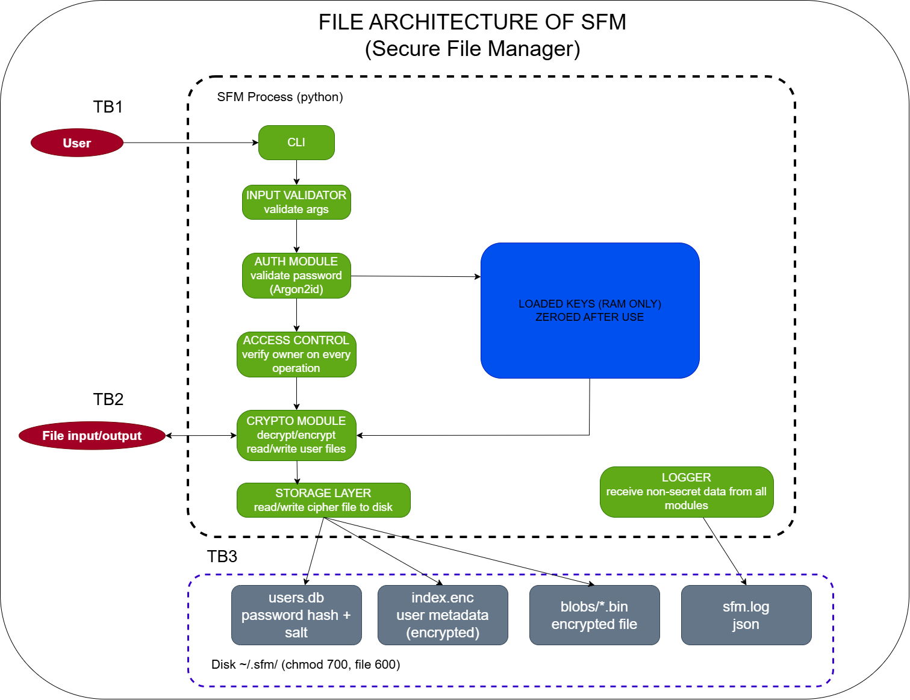

# Secure File Manager (`sfm`)
A local command-line tool that encrypts, stores, retrieves and securely deletes files in a per-user encrypted vault. 

> **Status:** Checkpoint 3 (near-final): all core features, security hardening and the test suite are implemented. Only `passwd` and `--remove-original` are still planned.

## Scope

**In scope**

- Multi-user vault on a single machine: several accounts can use the same installation, each with private storage.
- Authenticated encryption of files (AES-256-GCM)
- Password authentication with Argon2id and a per-user random salt.
- Encrypted metadata (file names, owners, keys), so the vault directory reveals nothing about its content.
- Per-user access control on every file operation.
- Input validation and sanitisation (paths, arguments, passwords).
- Structured logging without secrets and generic user-facing errors.
- Clean handling of interruptions (Ctrl+C, `SIGTERM`) and detection of tampered or damaged data.

**Out of scope**

- Any network component: this is a local tool
- Attackers with root or malware running as the same user while the vault is unlocked or any hardware attacks.
- Password recovery: a lost password means lost data, by design.
- Guaranteed memory wiping and guaranteed secure deletion on SSD

Threat model, architecture diagram and trust boundaries:



Full architecture, trust boundaries and threat model: see the design document submitted for Checkpoint 1.

## Commands

The user is identified with `--user`. The password is asked at every invocation (no persistent session), without echo, and is never accepted on the command line.

| Command | Description |
|---|---|
| `sfm register <username>` | Create a new user and an empty encrypted vault (password asked twice) |
| `sfm --user <name> encrypt <path>` | Encrypt a file into the vault and print its ID |
| `sfm --user <name> decrypt <id> -o <dest> [--force]` | Decrypt a vault file to `<dest>`; refuses to overwrite unless `--force` |
| `sfm --user <name> list` | List the user's own files (ID, original name) |
| `sfm --user <name> delete <id>` | Delete a file and destroy its key |
| `sfm --help` | Show usage |

**Planned, not implemented yet:** `sfm --user <name> passwd` (change the password, re-encrypting the index only) and `encrypt --remove-original` (securely delete the plaintext original).

Example:

```bash
sfm register alice
sfm --user alice encrypt ~/documents/thesis.pdf
sfm --user alice list
sfm --user alice decrypt 7 -o ~/restored/thesis.pdf
sfm --user alice delete 7
```

### Input rules

- Username: 3-32 characters, letters, digits, `_` or `-`.
- Password: 8-128 characters at registration.
- Source file: a regular file of at most 100 MiB; symbolic links and control characters in the path are rejected.
- Destination: its directory must exist; an existing file is replaced only with `--force`.

### Exit codes

`0` success, `1` expected error (bad input, wrong password, damaged data, access denied), `2` usage or internal error, `129`/`143` terminated by `SIGHUP`/`SIGTERM`, `130` interrupted with Ctrl+C. Error messages are generic and never show a stack trace; details go to the log.

## Requirements

- Python 3.11 or newer
- Linux (developed and tested on Linux). Not tested on Windows or macOS.
- No compiler needed

## Build and run

```bash
git clone https://github.com/Zhomm/secure_programming_project.git secure-file-manager
cd secure-file-manager

python3 -m venv .venv
source .venv/bin/activate            

pip install -e .

sfm --help
```

`pip install -e .` installs the `sfm` command (and its dependencies from `pyproject.toml`) into the virtual environment, so the environment must be active whenever the tool is used. `pip install -r requirements.txt` installs only the dependencies.

Data is stored in `~/.sfm/` (directories `700`, files `600`):

```
~/.sfm/
├── users.db              usernames, salts and password verifiers (SQLite)
├── sfm.log               structured JSON audit log
└── vault/<user>/
    ├── index.enc         encrypted index (file names, wrapped keys)
    └── blobs/*.bin       one encrypted file each, random names
```

## Security features

- **Authentication:** Argon2id (256 MiB, 4 iterations, 4 lanes) with a random salt; HKDF-SHA256 separates the stored verifier from the in-memory encryption key; constant-time comparison; same work for unknown users.
- **Encryption:** a random key per file, AES-256-GCM with a fresh nonce; user and file ID are bound to each ciphertext as associated data.
- **Secure deletion:** the key is removed from the index first (crypto-erase), then the blob is overwritten, synced and unlinked.
- **Access control:** every operation checks that the user's directories are private, owned by the current OS user and not symbolic links.
- **Input validation:** whitelist for usernames, path canonicalisation, no control or NUL characters, no symlink sources, parameterised SQL, no `subprocess`/`eval`/`os.system`.
- **Memory:** password, keys and plaintext are held in `bytearray`s and zeroed in `finally` blocks; no core dumps.
- **Integrity:** tampered, truncated or deleted index, files or user database are detected and reported.
- **Interruptions:** Ctrl+C, `SIGTERM` and `SIGHUP` clean up temporary files; writes are atomic.
- **Logging:** one JSON line per event (time, event, outcome, user, source, ids); only whitelisted fields, so no secrets, file names or paths.

### Known limitations

- Python cannot guarantee that secrets are erased from memory (immutable `str`/`bytes`, library copies, swap).
- Overwriting cannot be guaranteed on SSDs or journaling/copy-on-write file systems.
- `kill -9` and power loss cannot be handled; they may leave an unreadable orphan blob.
- An older valid copy of `index.enc` is not detected (no version counter).
- Two `sfm` processes on the same account at the same time can lose an index update.
- There is no lockout after failed logins: it would allow locking other users out, and the Argon2id cost already makes guessing expensive.

## Tests

```bash
pip install -r requirements-dev.txt
pytest tests -v
```

The tests use a temporary home directory and cheap Argon2 settings: the real `~/.sfm` is never touched. They cover encryption and decryption correctness, secure deletion, authentication failures, input-validation edge cases, access control, tampering, interruptions, logging without secrets and memory wiping.

## Repository layout

```
secure-file-manager/
├── .gitignore
├── README.md
├── pyproject.toml
├── requirements.txt
├── requirements-dev.txt
├── docs/
│   └── architecture.png
├── src/sfm/
│   ├── cli.py            command-line interface, signal handling
│   ├── auth.py           registration and login
│   ├── crypto.py         AES-256-GCM helpers
│   ├── vault.py          encrypt, decrypt, list, delete
│   ├── storage.py        paths, permissions, atomic writes, secure delete
│   ├── validation.py     input validation
│   ├── secmem.py         wipeable secrets, no-echo input, process hardening
│   └── log.py            structured audit log
└── tests/
```

## Dependencies

- [`cryptography`](https://cryptography.io/): AES-256-GCM, HKDF
- [`argon2-cffi`](https://argon2-cffi.readthedocs.io/): Argon2id password hashing and key derivation
- Standard library: `argparse`, `pathlib`, `sqlite3`, `logging`, `signal`, `termios`
- Development only: [`pytest`](https://docs.pytest.org/)


## Author

Tommaso, 265856IVCM. Course: ICS0022 Secure Programming, 2026/2027 autumn semester.
